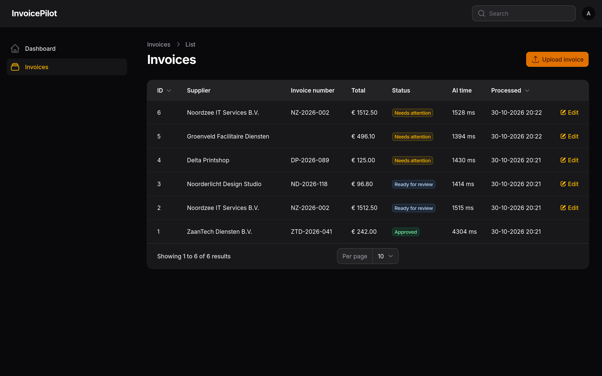
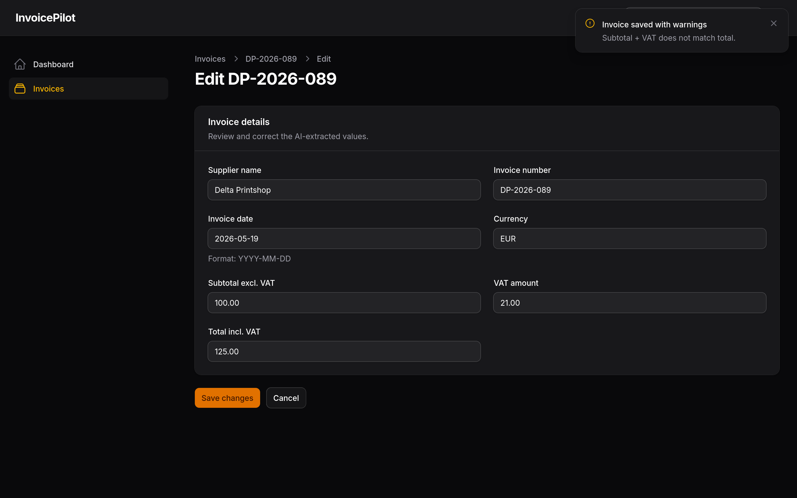

# InvoicePilot

A small Laravel application that uses a local LLM to extract and review PDF invoices.

InvoicePilot takes a PDF invoice, extracts its text, and sends it to Ollama to identify fields like the supplier, invoice number, dates, and amounts. The extracted data is then checked against a set of validation rules before being presented for manual review.

The project started as an experiment in integrating an LLM into a Laravel application, with a focus on structured output, validation, and handling unreliable model responses.

## Screenshots

### Invoice overview



### Invoice review



## Features

- PDF upload and text extraction
- Structured invoice extraction using Ollama and JSON Schema
- Validation of required fields, dates, amounts, and currency
- Duplicate invoice detection
- Manual corrections and approval through Filament
- Original AI output preserved alongside corrected values
- Configurable Ollama model
- Automated tests and a small evaluation dataset

## Tech stack

- PHP 8.5 / Laravel 13
- Filament 5
- SQLite
- Ollama (Qwen3 4B Instruct by default)
- [smalot/pdfparser](https://github.com/smalot/pdfparser)
- PHPUnit

Everything runs locally. No external AI API or cloud infrastructure is required.

## How it works

When an invoice is uploaded, the application extracts the text from the PDF and passes it to Ollama. The model returns seven fields in a predefined JSON structure.

The result goes through regular PHP validation to check things like missing fields, invalid dates, amount mismatches, unsupported currencies, and duplicate invoices.

Invoices are then assigned one of three statuses:

| Status             | Description                    |
| ------------------ | ------------------------------ |
| `READY_FOR_REVIEW` | All automatic checks passed    |
| `NEEDS_ATTENTION`  | One or more checks failed      |
| `APPROVED`         | Manually reviewed and approved |

Users can correct extracted values and run validation again. The original model output is kept separately so corrections don't overwrite what the model initially returned.

An invoice can only be approved manually, after all validation checks pass.

## Getting started

### Requirements

- PHP 8.3+ with the required Laravel extensions
- Composer
- SQLite
- Ollama

The project was developed with PHP 8.5, Laravel 13, and an NVIDIA RTX 2060 (6 GB).

### Installation

Clone the repository and install dependencies:

```bash
git clone https://github.com/damienhensen/InvoicePilot.git
cd InvoicePilot

composer install
cp .env.example .env
php artisan key:generate
```

Configure SQLite in `.env`:

```env
DB_CONNECTION=sqlite
```

Create the database file if it doesn't exist, then run the migrations:

```bash
touch database/database.sqlite
php artisan migrate
```

### Ollama configuration

Install [Ollama](https://ollama.com/) and download the default model:

```bash
ollama pull qwen3:4b-instruct
```

Make sure Ollama is running on `http://127.0.0.1:11434`.

The model is configured through `.env`:

```env
OLLAMA_MODEL=qwen3:4b-instruct
```

You can switch to another locally installed Ollama model by changing `OLLAMA_MODEL`. The selected model needs to support structured JSON output.

No PHP changes are needed when switching models. If Laravel's configuration is cached, run:

```bash
php artisan config:clear
```

### Start the application

Create a Filament user:

```bash
php artisan make:filament-user
```

Start Laravel:

```bash
php artisan serve
```

The admin panel is available at `http://localhost:8000/admin`.

## Testing

Run the test suite with:

```bash
php artisan test
```

The project includes 40 automated tests covering PDF processing, invoice validation, mocked Ollama responses, duplicate detection, manual corrections, and approval rules.

Ollama doesn't need to be running for the automated tests.

## LLM evaluation

I also put together a small evaluation set of 12 synthetic invoice cases covering different layouts, missing information, inconsistent amounts, and a prompt-injection attempt.

The first run revealed an interesting issue: Qwen occasionally changed invoice numbers during extraction. For example, `HC-2026-500` was consistently returned as `HC-2026-50`, even though the PDF text had been extracted correctly.

After updating the prompt to explicitly preserve identifiers character-for-character, I ran the evaluation again.

| Metric                     | Initial prompt | Updated prompt |
| -------------------------- | -------------: | -------------: |
| Correct fields             |          83/84 |          84/84 |
| Fully correct invoices     |          11/12 |          12/12 |
| Field validation agreement |          12/12 |          12/12 |
| Average processing time    |          1.49s |          1.51s |

These results were measured using `qwen3:4b-instruct` on the local evaluation dataset. They don't necessarily apply to other Ollama models.

The prompt was improved using errors found in that same dataset, so the final score shouldn't be interpreted as accuracy on unseen invoices.

Database-dependent duplicate detection is tested separately.

The evaluation cases, ground-truth data, and details about the prompt changes are available in [evaluation/README.md](evaluation/README.md).

## Limitations

This is a portfolio project, not production-ready accounting software.

A few things are intentionally out of scope:

- Scanned PDFs and OCR
- PDFs larger than 3 MB or longer than 3 pages
- Payments or accounting integrations
- Automatic invoice approval
- Cloud deployment

The application treats PDF content as untrusted input and doesn't give the model access to application actions. However, the included prompt-injection test doesn't guarantee protection against every possible attack.

The evaluation uses fictional invoices only. No real financial documents are needed.

## Development

This project was built with AI-assisted development. AI was used to help write and iterate on implementation code and tests, while the integration, validation behavior, and evaluation results were tested and reviewed locally.
